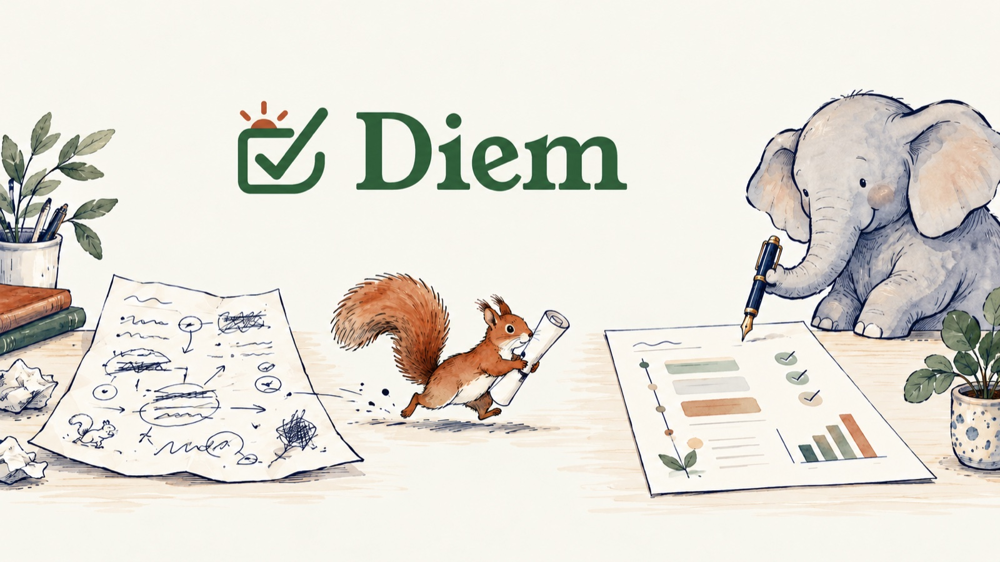
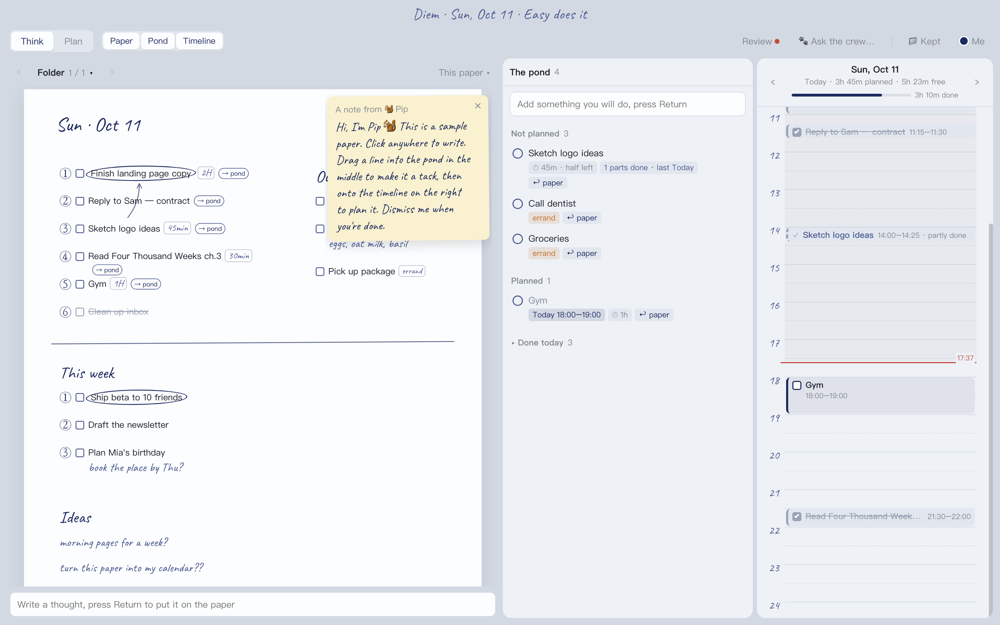
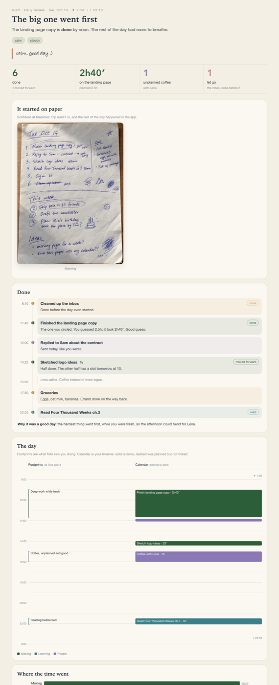

<p align="center"><b>English</b> · <a href="README.zh-CN.md">简体中文</a></p>

<p align="center"></p>

<h3 align="center">Handwrite your day. Get a beautiful day back.</h3>


Diem is a Mac app for one day at a time: a paper for loose thoughts, a pond for the things you'll actually do, and a timeline. There is no AI inside the app. **The AI is your [Claude Code](https://claude.com/claude-code)**: it reads a photo of your handwritten page, plans your day, and writes you a daily review in the evening. Every change it makes comes with a note you can undo.

[**Download Diem for Mac**](https://github.com/daisycao/diem/releases/latest) · macOS 14+ · Apple silicon & Intel · MIT



## How a day goes

**Morning: write it down.** Scribble on paper the way you always do: circle what matters, number things, draw arrows, write "2H" next to a task. Snap a photo and drop it on Diem. In Claude Code, say *"Import my paper"* and 🐿️ Pip turns it into a paper you can drag around. Or just type straight onto the paper in the app.

**Midday: make it real.** Drag a thought into the **pond** and it becomes a task. Drag a task onto the **timeline** and it's planned. Or say *"Toto, plan my day"* and 🐘 Toto proposes a plan with white space left in it; you see dashed outlines, then accept, pick, or say no. Turn on **Write to Calendar** and every block lands in a "Diem" calendar, so your iPhone shows it and reminds you.

**All day: just use the app.** Tick things off, drag them around, log what you did. No need to touch the paper again (though if you'd rather tick the sheet and snap it once more at night, Pip can read that too).

**Evening: look back.** Say *"Write my daily review"*. 🐘 Toto writes you a page that starts from your handwritten sheet: what got done, how the day went against the plan, where the time went, and what tomorrow looks like.

<p align="center"></p>

## Meet the crew

<p align="center"></p>

They live in Claude Code. Whatever they touch, they sign.

| | | |
| --- | --- | --- |
| 🐿️ | **Pip** | *Picks up every scrap you drop.* Jots, paper imports, tidy-ups. |
| 🐘 | **Toto** | *Steady, and never forgets.* Plans your day, writes your daily review. |
| 🐶 | **Fetch** | *Sniffs out ideas — only when you call.* |
| 🐦 | **Zaza** | *Chirps when something needs you.* Due dates and nudges (Labs). |

## Why there's no AI inside

- **Your files, on your Mac.** Everything is plain JSON and Markdown in one folder (`~/Documents/Diem`). No account, no server, no API key.
- **Claude Code does the thinking.** The folder comes with a `CLAUDE.md` that teaches Claude Code how Diem works. Open Claude Code there and talk to it.
- **Nothing changes behind your back.** Every AI change leaves a memo in the app: accept it, undo it all, or undo one line. Big changes (planning a day, tidying the paper) arrive as proposals and only happen when you say so.
- **The review learns.** Tell Toto "that's wrong" about a review and it writes the lesson to `review/lessons.md` and follows it next time.

## Get started

1. [Download](https://github.com/daisycao/diem/releases/latest) `Diem.dmg`, drag Diem to Applications, and open it.
   The app isn't notarized yet, so the first time macOS may refuse: right-click Diem → **Open** → **Open**, or go to System Settings → Privacy & Security → **Open Anyway**.
2. Diem creates `~/Documents/Diem` with a sample day in it. (Me → *Use another folder…* to pick a different one.)
3. Install [Claude Code](https://claude.com/claude-code), then:
   ```bash
   cd ~/Documents/Diem
   claude
   ```
4. Try: *"Toto, plan my day"*. Then drop a photo of a handwritten page on the app and say *"Import my paper"*.

Any blank sheet of paper works. A pen in dark blue or black reads best.

**Jot from anywhere.** Add this line to your global `~/.claude/CLAUDE.md` and you can say "jot: …" in any Claude Code session:
```
When I say "jot: …", run node ~/Documents/Diem/bin/jot.mjs "…"; for "add to pond: …" add --list.
```

## Labs

All off by default, in Me → Labs:

- **One brain**: a Claude Code hook logs every step the AI takes in your Diem folder, and its guesses about you wait for your OK. To install the hook, add a `PostToolUse` hook to `~/.claude/settings.json` that runs `node ~/Documents/Diem/bin/sync-hook.mjs`.
- **Zaza**: Mac notifications for due dates and things you're waiting on.
- **Places**: Diem reads your Wi-Fi name to know if you're home or at the office, and floats up what you can do there.
- **Colors follow the almanac**: picks one of six ink colors from the day's Chinese stem-and-branch element. Just for a good mood.

## Build from source

```bash
git clone https://github.com/daisycao/diem.git
cd diem
./build.command        # or: zsh app/build-app.sh
```
Needs Xcode command line tools and Node 20+. The UI is TypeScript (`app/web/src`) in a small Swift shell (`app/native`). For browser debugging: `DIEM_WS=/some/copy node app/tools/dev-server.mjs` and add `?lang=en` or `?lang=zh`.

## Sister app

[**Anew**](https://github.com/daisycao/anew): read with Claude in the margins. Notes attached to a block on your paper open in Anew if you have it.

---

*Carpe diem.* MIT License.
